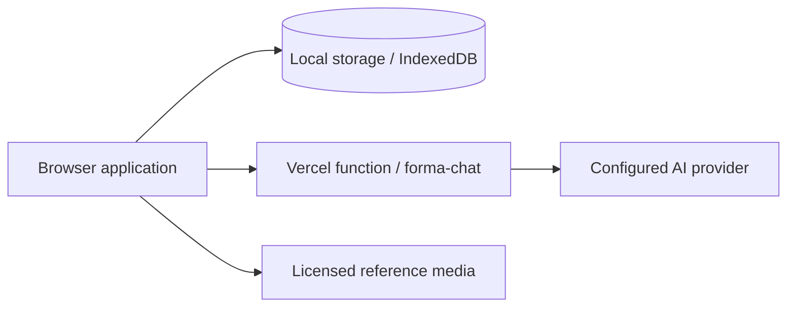

# Traincore — engineering quality / engenharia
Owner: João Victor da Silva (JustJao1).
EN: Workout planning, rest timers, history and educational nutrition/training assistance.
PT: Planejamento de treinos, descanso, histórico e assistência educativa.

ADR-001: Retain FORMA1 code compatibility; do not include private local media in shared codes. ADR-002: AI is educational and optional; secrets stay server-side. ADR-003: Respect the upstream media licenses in README.
## Local container
docker compose up --build --wait; open http://localhost:8080/. This is a static UI preview, not a Vercel Functions emulator: AI calls are unavailable. No credentials or external datasets are included. Stop with docker compose down.
## Verification
node tests/static.cjs. [CI](https://github.com/JustJao1/traincore/actions/workflows/engineering-quality.yml) runs the existing static checks and container health; static checks are not runtime coverage. Browser exercise remains separate.
## Demo (EN)
Create a workout, start a rest timer, record a set, review history and export/share a fictional plan. Explain the local data and sharing boundary.
## Demonstração (PT)
Crie uma ficha, inicie o descanso, registre uma série, veja o histórico e compartilhe um treino fictício.
## AI-assisted review
Review code and licensed assets, test data migration and UI, inspect CI output, and avoid passing personal health records or secrets to an AI service. This is an ongoing review policy.
